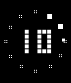
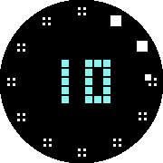
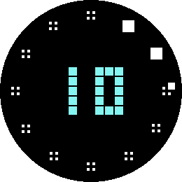
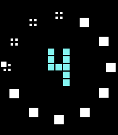
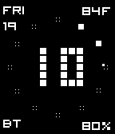
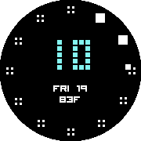
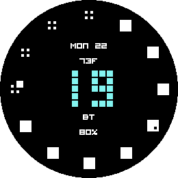
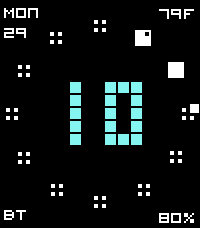
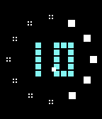
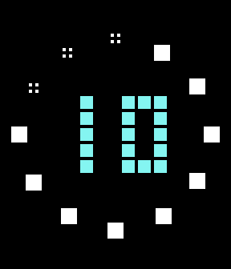

# Pebble Minute Blocks

A Pebble C watchface with twelve five-minute markers around the edge, each
starting as four tiny dots. As the current five-minute block advances, the dots
become square pixels one at a time; when the block is complete, it turns into a
larger box.

The center uses a chunky pixel-style hour readout. Minutes live only in the
outer ring, with small date, weather, battery, and Bluetooth status
complications around the main hour.

The face has per-platform sizing across the Pebble screens: the compact 144×168
watches, the round Pebble Time Round, the larger Pebble Time 2 / `emery`, and the
big round Pebble Round 2 / `gabbro`.

## Screenshots

| Pebble / Pebble 2 | Pebble Time Round | Pebble Round 2 | Pebble Time 2 |
| --- | --- | --- | --- |
|  |  |  |  |
|  |  |  |  |

The complication text uses the Visitor bitmap font by Ænigma, distributed via
DaFont as 100% free. It is bundled at 15, 20, and 25 px sizes so the small
status labels and numbers stay crisp on low-resolution Pebble screens.

## Animations

Optional "Kinetic" mode (off by default — enable it in settings) adds motion to
the ring:



Each minute, a new block falls into place on the active marker.



When a five-minute marker completes the four blocks stretch apart and smash
together, and at the top of each hour every block cascades off the bottom.
PT2 Large mode mixes larger chips into the fragment burst for better visibility.

*(Captured on the emulator at ~10 fps; the animations run smoothly at 30 fps on
real hardware.)*

In PT2 Large mode, the final launch pulse breathes inward to keep the blocks
inside the display; Normal mode retains the outward pulse.

## Build

Built and checked with Pebble SDK 4.44 for all seven target platforms.

The app uses manifest version 2 for optional phone-side plugin readings. It declares
Location and Internet access limited to `api.open-meteo.com` for existing weather,
and Health for the existing watch steps source. Legacy capabilities are retained
for older companion apps. Declaring permissions does not grant them: the Pebble
app may ask for approval. Denied weather permissions retain the existing unavailable
weather behavior; plugin errors restore the slot's selected built-in reading.

The Pebble SDK needs its bundled ARM toolchain, so the included `justfile`
clears host compiler overrides such as `CC=/opt/homebrew/bin/gcc-15` before
building:

```sh
just build
```

You can still call the Pebble SDK directly if your shell does not override the
C compiler:

```sh
pebble build
```

Run the settings, weather expiry, hour layout, and complication value regression tests with `just test`
(Node.js and a C compiler required).

## Complication Data

Built-in sources prepare bounded `ComplicationValue` records from a snapshot of
the clock, cached weather, battery, connection state, and cached steps. Rectangular
drawing, round-screen labels, and collision checks all consume those records.
Unavailable readings retain their existing placeholders; an empty slot has no
display value. Source IDs and saved corner choices retain their existing values.

Built-in readings remain the default. On companion apps with the plugin API,
each slot also offers Plugin favorite 1–5, in the order returned by the Pebble
app's preferred-complication list. Choose favorites in the Pebble app and select
one in Minute Blocks' settings. The slot's ordinary source remains its fallback;
choosing None there makes the slot empty while a plugin is unavailable.

The phone reads `preferences/complications`, follows the selected source/property
and instance index, and sends short text or numeric readings through the same
layout and collision code as built-ins. Text is limited to seven printable ASCII
characters; degree signs are removed, dashes normalized, numbers rounded to one
decimal, and unsupported characters omitted. Oversized readings fall back rather
than cutting digits off a number. Images, series, timestamps and actions
are not supported in this first version. On rectangular watches, opposing plugin
readings that overlap another slot fall back to their built-in readings, keeping
text size unchanged. Actual ink bounds determine whether they fit.

Missing APIs, disabled plugins, denied permissions, missing favorites, unsupported
shapes and source errors leave built-ins working. A source error clears its live
reading and retries only that subscription after 1, 5, and 15 minutes, then stops
retrying until the next settings/session refresh. Later source updates can still
recover it, including after a permission grant. Unrelated slots keep running.
Readings expire at the provider's validity limit, capped at 15 minutes (one minute
when the validity limit is omitted or null), and fall back on the next redraw, normally
within a minute. Live readings are not persisted. Favorite choices are retained
when using an older companion app, whose settings page hides the plugin controls.

Settings and live values use separate bounded dictionaries, serialized through a
single AppMessage queue with coalescing. The queue recomputes remaining lifetime
at every send and retry, clearing values that expired while waiting. Failed
plugin settings retry after 1 and 5 minutes, then every 15 minutes until delivered
or replaced; plugin readings wait for settings acknowledgement while other
traffic continues. Identical acknowledged readings are skipped until renewal is
needed, and extending an unchanged watch reading does not force a redraw. Changing settings
unsubscribes old sources and ignores their late callbacks. Only favorite choices,
not live values, write to watch persistence.

Plugins are still a preview in the Pebble companion app. This branch can be tested
with plugins enabled or disabled; public release needs both companion-app paths
verified. See the [plugin preview documentation](https://developer.repebble.com/guides/plugins/preview/).

All seven platforms check visible complication text and icons against the hour's
lit pixels and every resting ring-marker state. On a collision, rectangular
layouts move the ring inward in two-pixel steps; round layouts retain its radius.
Squares, dots, and their spacing scale together, and the hour shrinks independently
only when needed. The selected complication text size is preserved, with a
one-pixel clearance. The bounded fit restores larger sizes when values or available
space change; unusually long values still use the existing text ellipsis.
Text is measured once per changed layout, and the resulting ink rectangles are
reused throughout fitting. Layout results are cached between frames with unchanged
data and geometry. Banner compression scales markers against the full canvas even
when no extra collision inset is needed. Drawing and collision tests share the
same hour-pixel and steps-icon geometry. All platforms and hour sizes center the
visible digit edges, including hours with a narrow `1` glyph.

## Install

For the Pebble Time / Time Steel emulator, use the compact `basalt` target:

```sh
just install --emulator basalt
```

For the Pebble Time 2 emulator, use the larger `emery` target:

```sh
just install --emulator emery
```

For a physical watch through the Pebble/Rebble app developer connection:

```sh
just install --phone PHONE_IP
```

## Settings

The Pebble app settings page supports:

- background color
- minute ring color
- complication color
- center digit color
- color presets, including the default cyan center digits with white ring and
  complications
- time mode: watch setting, 12-hour, or 24-hour
- 24-hour leading zero: show (default) or hide, including when following the watch setting
- block size on Pebble Time 2: normal or large (both center hour and outer ring);
  Large mode centers all two-digit hours using the visible digit pixels, and
  adapts the ring, individual squares/dots, and hour when visible complications
  risk overlapping the blocks; collision sizing also applies to the other watches
- complication size: normal, medium, or large
- complication visibility: always shown, or hidden until you shake the watch
  (or wake the backlight on supported firmware)
- subtle seconds sweep: never, always, or hidden until you shake the watch
  (or wake the backlight on supported firmware)
- kinetic animations: blocks fall in, smash together on completion, and cascade
  at the top of the hour (off by default)
- each corner complication: none, date, current temperature, forecast range,
  battery, Bluetooth, or steps
- weather on/off
- weather units: Fahrenheit or Celsius

Weather uses PebbleKit JS on the phone with location permission and Open-Meteo.
It refreshes current temperature and the day's forecast range on startup and
every 30 minutes. Failed, incomplete, or timed-out responses show unavailable
weather. Cached readings expire after two hours, including while disconnected
or after restarting the watchface. Switching temperature units hides the old
reading until a fresh response arrives.

## Battery

At rest the face only updates once a minute, and reveal is event-driven (a wrist
shake), so there's no constant polling. The kinetic animations are short bursts —
roughly 2% of the time — rather than a continuous draw. With animations on and
seconds off, Battery+ estimated about two weeks on a Pebble Time 2; this is an
estimate that varies by watch and use. Always-on seconds is the one option that
shortens runtime noticeably, since it redraws every second.

## Store Assets

Store listing copy, screenshots, and listing icons live in `store-assets/`.
Those files are intended for appstore/developer portal forms; the PBW itself
only embeds the small `resources/images/menu_icon.png` menu icon.

### Screenshots

| Platform | Normal | Active complications | Event overlay | Active overlay |
| --- | --- | --- | --- | --- |
| Pebble / Pebble 2 (`aplite`) | [Normal](store-assets/screenshots/aplite-normal.png) | [Active](store-assets/screenshots/aplite-active.png) | [Overlay](store-assets/screenshots/aplite-overlay.png) | [Active overlay](store-assets/screenshots/aplite-overlay-active.png) |
| Pebble Time / Time Steel (`basalt`) | [Normal](store-assets/screenshots/basalt-normal.png) | [Active](store-assets/screenshots/basalt-active.png) | [Overlay](store-assets/screenshots/basalt-overlay.png) | [Active overlay](store-assets/screenshots/basalt-overlay-active.png) |
| Pebble Time Round (`chalk`) | [Normal](store-assets/screenshots/chalk-normal.png) | [Active](store-assets/screenshots/chalk-active.png) | - | - |
| Pebble Round 2 (`gabbro`) | [Normal](store-assets/screenshots/gabbro-normal.png) | [Active](store-assets/screenshots/gabbro-active.png) | - | - |
| Pebble 2 SE (`diorite`) | [Normal](store-assets/screenshots/diorite-normal.png) | [Active](store-assets/screenshots/diorite-active.png) | [Overlay](store-assets/screenshots/diorite-overlay.png) | [Active overlay](store-assets/screenshots/diorite-overlay-active.png) |
| Pebble Time 2 (`emery`) | [Normal](store-assets/screenshots/emery-normal.png) | [Active](store-assets/screenshots/emery-active.png) | [Overlay](store-assets/screenshots/emery-overlay.png) | [Active overlay](store-assets/screenshots/emery-overlay-active.png) |

Regenerate the screenshot set with:

```sh
just screenshots
```

### Animations

The kinetic demo GIFs in `store-assets/animations/` are captured from an emulator
with `scripts/capture-animation.py`, which jumps the clock to an animation's
trigger, enables Kinetic mode, burst-grabs frames, and writes a looping GIF.
Install the build on the emulator first, then capture (`--scale 1` for native
144×168, store-ready size):

```sh
just install --emulator basalt
just capture-animation --scale 1 --at 10:44:57 --duration 3.5 --out /tmp/smash.gif
```

(`just capture-animation` runs the script with the SDK's Python; override with
the `PEBBLE_PYTHON` env var if your SDK lives elsewhere.)

Trigger windows: falling block `--at 10:25:56 --duration 5.0`; smash
`--at 10:44:57 --duration 3.5`; top-of-hour smash+cascade
`--at 11:59:57 --duration 4.5`.

Notes (see the script's docstring for more):
- The emulator renders kinetic at only ~10 fps, so the sub-second falling block
  is choppy; the smash/cascade are long enough to read. Record real hardware for
  smooth clips.
- Only basalt/chalk/aplite/diorite take a clock-set — PT2 (`emery`) and Round 2
  (`gabbro`) emulators don't.
- Right after install the emulator is pokey, so the first capture often comes
  out static or partial — just run it again (two or three tries usually works).
- If captures stay static after retrying, the emulator has wedged: `pebble
  wipe`, reinstall, retry.
- Don't post-process with `magick -layers optimize` — it leaves a pixel trail of
  the block's old positions. Use `-coalesce` if you must re-encode, and rebuild
  from the relevant frames to trim a clip to just the motion.

## Minute Ring

- Future five-minute blocks: four small dots.
- Current block, minutes 1-4: one dot becomes a square each minute.
- Completed blocks: one larger box.
- The first block, minutes 1-5, sits at 1 o'clock; minutes 6-10 sit at 2
  o'clock, and so on.
